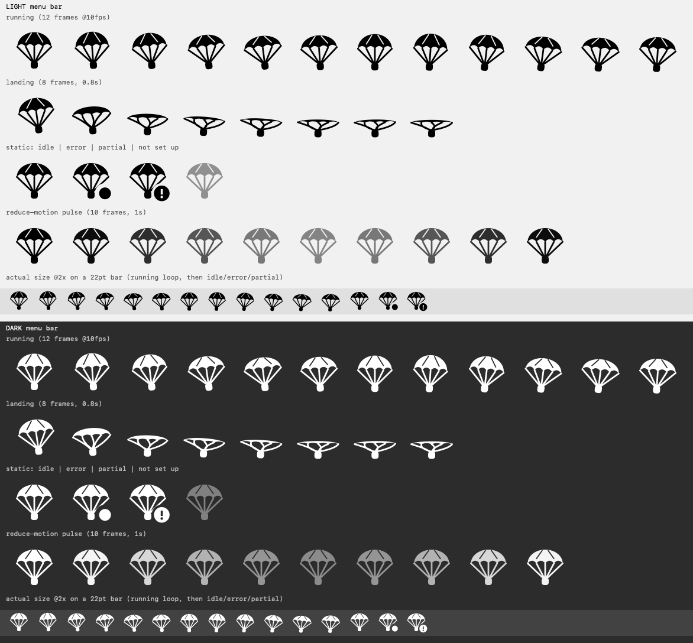

# parachute

Crash-proof your uncommitted work. Every few minutes `parachute` snapshots the dirty and untracked files of **every git repo and worktree** under directories you choose, and pushes the snapshots (plus local-only branch tips) to hidden `backup/*` branches on your **private** remote. Works as a Claude Code skill (`SKILL.md`) or standalone.


Why: `git` protects only what you committed *and pushed*. A kernel panic, dead SSD or `rm -rf` in the wrong terminal loses everything else.

## 60-second quickstart

```sh
git clone https://github.com/ryanramtin/parachute ~/parachute && cd ~/parachute
gh auth login                                   # needed for the private-repo check
bash scripts/install.sh --roots ~/code,~/work   # writes config, links ~/.local/bin/parachute, renders plist, DRY RUN only
parachute run --only ~/code/myrepo              # real run on one repo (or: bash scripts/parachute.sh run --only ...)
git -C ~/code/myrepo ls-remote origin 'refs/heads/backup/*'
bash scripts/install.sh --enable                # macOS: schedule it (default every 10 min)
```

## CLI

```
parachute run [--dry-run] [--only <repo>] [--verbose] [--prune-remote-older-than <days>]
parachute restore [worktree-path | ref | sha]
parachute status      # human-readable status.json
parachute version
parachute help        # also the default with no arguments
```

`install.sh` symlinks `~/.local/bin/parachute` to `scripts/parachute.sh` (idempotent; never overwrites a real file; make sure that directory is on your `PATH`). `uninstall.sh` removes only that symlink. The scheduler runs `parachute.sh run`.

## Status of this project

Early. Tested on macOS only (bash 3.2, git, local bare-repo origins). **Unverified:** pushing to a real GitHub remote (the `gh repo view` privacy check against a live repo), the real `launchctl bootstrap` path, and macOS TCC / Full Disk Access behaviour under launchd. Linux is untested.

## Safety model

- **Never touches your repo state.** Snapshots use a temporary index; your real index, `HEAD`, branches and working tree are untouched. Snapshots live in `refs/backup/*` (local, hidden from `git branch`).
- **Pushes only to `refs/heads/backup/<namespace>/...`.** A hard guard (`assert_refspec`) rejects any other destination; one bad refspec aborts the entire batch. Covered by `test/run.sh`.
- **Private remotes only.** Before pushing, the origin is checked with `gh repo view --json isPrivate`. Public, unknown-host, no-origin and unauthenticated repos are skipped (local snapshots are still kept). Local-path remotes are allowed.
- **Respects `.gitignore`.** Ignored files are never captured.
- **Secrets and big files.** *New* files named `.env*` (except `.env.example|sample|template|dist`), `*.pem`, `*.key`, `*.p12`, `*.pfx`, `*.p8`, `*.jks`, `*.keystore`, `*.mobileprovision`, `id_rsa*`/`id_ed25519*`/`id_ecdsa*`, `.npmrc`, `.netrc`, `credentials.json`, `service-account*.json`, `*.secret(s)` are dropped, as are new files over `MAX_FILE_MB`. Files already tracked in `HEAD` are not filtered (they're already in your repo). This is a safety net, not a secret scanner.
- **`--force --no-verify` pushes.** Backup refs are owned by this tool and rewritten each snapshot, hence `--force`. `--no-verify` skips pre-push hooks: those are meant for real pushes (tests, lint, policy), would run unattended every interval, and could block or slow the backup. Only backup refs are ever written.
- **Lock + log.** One run at a time (stale locks recovered); log rotates at 5 MB.

## How restore works

```sh
parachute restore ~/code/myrepo
```

Lists snapshots and **prints** commands (never runs them): inspect (`git show --stat`, `git diff HEAD <ref>`) and recover (checkout files, apply patch, or create a rescue branch + worktree). Each snapshot is a commit whose parent is your `HEAD` at that time and whose tree is your working tree. On a new machine: `git fetch origin 'refs/heads/backup/*:refs/remotes/origin/backup/*'` then pass `refs/remotes/origin/backup/<namespace>/<branch>--<dirname>`.

Remote branch names: `backup/<namespace>/<branch>--<worktree-dir>` for snapshots and `backup/<namespace>/<branch>--branch-tip` for unpushed local branches (newer than `TIP_DAYS`, not contained in any remote-tracking ref).

## Config

`~/.config/parachute/config` (override path with `PARACHUTE_CONFIG`) is a sourced bash file. No config means no run: the tool refuses to guess what to scan.

| Variable | Default | Meaning |
|---|---|---|
| `ROOTS=( ... )` | none (required) | directories to scan for repos |
| `EXTRA_ROOTS=( ... )` | empty | more directories (e.g. a worktree dir elsewhere) |
| `INTERVAL` | 600 | seconds between runs (used by `install.sh`) |
| `MAX_FILE_MB` | 20 | skip new files bigger than this |
| `TIP_DAYS` | 90 | ignore unpushed branch tips older than this |
| `MAX_DEPTH` | 5 | search depth under each root |
| `EXCLUDE=( ... )` | empty | shell globs matched on absolute repo/worktree path, e.g. `( "*/scratch/*" )` |
| `PUSH` | 1 | `0` = local snapshots only |
| `BACKUP_NAMESPACE` | short hostname | the `<namespace>` in `backup/<namespace>/...` |

Flags (for `run`): `--dry-run`, `--only <repo>`, `--verbose`, `--prune-remote-older-than <days>`. Env: `PARACHUTE_CONFIG`, `PARACHUTE_LOG`, `PARACHUTE_STATE` (state dir), `PARACHUTE_PUSH_TIMEOUT`, `PARACHUTE_SCHEDULED`, `PARACHUTE_BIN_DIR`, `PARACHUTE_LAUNCHAGENTS_DIR`, `PARACHUTE_NO_LAUNCHCTL` (tests: never touch launchd). Cron users: put `SCHEDULED=1` in the config so `nextRunEpoch` is reported.

Logs: `~/Library/Logs/parachute.log` on macOS, `${XDG_STATE_HOME:-~/.local/state}/parachute/parachute.log` elsewhere.

## Status file

Each real pass (not `--dry-run`, not prune) writes `${XDG_STATE_HOME:-~/.local/state}/parachute/status.json` atomically (tmp file + `mv`): `state` (`idle|running|error`), `pid`, `lastRunStart`/`lastRunEnd` (epoch seconds), `lastResult` (`ok|partial|error`), counts (`reposScanned`, `worktreesScanned`, `snapshots`, `pushedRefs`, `skipped`), up to 20 `warnings`, and `nextRunEpoch` (`lastRunStart + INTERVAL` when scheduled, else `null`), plus `"version": 1`. An EXIT/TERM/INT trap marks an aborted pass as `state=error`; a `running` state whose pid is dead is treated as stale and recorded as an errored run on the next pass. `parachute status` prints it.

## Menu bar app



A native macOS menu bar companion lives in [`/app`](app/) (Swift 6, AppKit, no dependencies). The icon is a parachute drawn in code. It floats while a backup runs, lands when it finishes, and shows a badge if something needs attention. With Reduce Motion on it pulses instead. Menu: status, "Back up now", "Restore…", log, config, launch at login.

It reads `status.json`; the CLI does all the work. Build with `cd app && ./build-app.sh` (output: `app/build/Parachute.app`, ad-hoc signed, so right-click → Open the first time). Early: the animation and menu have been checked as rendered frames and a launch test, not yet by long daily use.

## Pruning old backup branches

Backup branches accumulate. Delete the old ones from every repo under your roots:

```sh
parachute run --prune-remote-older-than 30 --dry-run   # preview
parachute run --prune-remote-older-than 30
```

Only `refs/heads/backup/<your namespace>/*` can be deleted (same guard as pushes); other namespaces and normal branches are never touched. Age is the tip commit's date.

## Uninstall

`bash scripts/uninstall.sh` unloads and removes the launchd agent. Config, logs, local refs and remote branches are left alone; it prints how to prune them.

## Linux / other schedulers

The scripts are portable bash 3.2 (needs git, perl or coreutils `timeout`, and `gh` for GitHub remotes). Only the launchd plist is macOS-specific. cron:

```cron
*/10 * * * * /bin/bash /path/to/parachute/scripts/parachute.sh run >/dev/null 2>&1
```

systemd user timer:

```ini
# ~/.config/systemd/user/parachute.service
[Service]
Type=oneshot
ExecStart=/bin/bash %h/parachute/scripts/parachute.sh run
# ~/.config/systemd/user/parachute.timer
[Timer]
OnBootSec=2min
OnUnitActiveSec=10min
[Install]
WantedBy=timers.target
```
Then `systemctl --user enable --now parachute.timer`.

## FAQ

**macOS says it cannot read my folder / nothing happens when scheduled.** launchd jobs run under TCC. `~/Desktop`, `~/Documents`, `~/Downloads`, iCloud Drive and external volumes need permission. Grant **Full Disk Access** to `/bin/bash` (System Settings > Privacy & Security > Full Disk Access > `+`, press Cmd-Shift-G, enter `/bin/bash`). Or keep repos outside protected folders (e.g. `~/code`). Unreadable roots are logged as `WARN cannot read root`.

**Will backup branches trigger my CI?** Pushing a branch fires `on: push` workflows (GitHub Actions, etc.) on every backup. Restrict them (`on: push: branches-ignore: ['backup/**']`), or use `PUSH=0`/`EXCLUDE` for those repos.

**Does it show up in `git branch`?** Local snapshots live in `refs/backup/*`, not `refs/heads`. On the remote they are ordinary `backup/...` branches.

**Public repos?** Skipped for pushing, by design. **GitHub only?** The privacy check understands github.com remotes via `gh`; other hosts are `unknown-remote` and skipped (local-path remotes are allowed).

**Does it capture staged-but-uncommitted changes, deletions, submodules' contents?** Staged + unstaged + untracked changes and deletions of the repo itself, yes. Submodule contents are not recursed into.

**Tests?** `bash test/run.sh` (uses throwaway repos and a local bare origin; exits nonzero on failure).

## License

MIT
